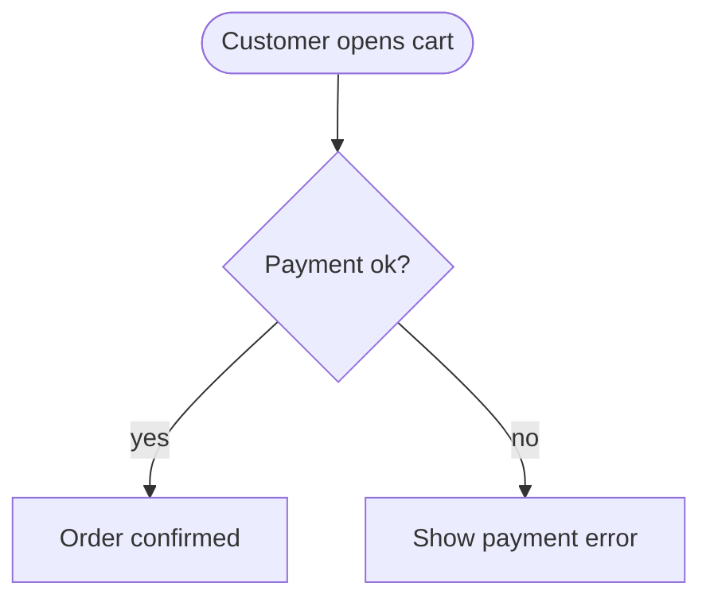

# strata

Mermaid flowcharts rendered as clean, readable terminal diagrams, built to
keep an architecture diagram open in a side pane while you (or your agent)
work on the code.

```
strata docs/architecture.mmd           # render once
strata --watch docs/architecture.mmd   # redraw on every save
cat flow.mmd | strata --dir=LR         # stdin, override direction
```

The source of truth is plain Mermaid in your repo, so diagrams diff, review
and version like code. The layout engine is where the work went, because
that's where terminal diagram tools usually fall apart.

## Install

```bash
cargo install --path .
```

For the library only, disable the default CLI feature:

```toml
strata = { version = "0.2", default-features = false }
```

## Usage

```
Usage: strata [OPTIONS] [FILE] [COMMAND]

Commands:
  diff [REF]          Catalog changes since REF (default HEAD), including uncommitted edits
  flows [NAME]        List use cases, or render one
  guide               Convention for AGENTS.md or CLAUDE.md
  completions <SHELL> Generate completions for bash, zsh, fish, powershell or elvish

Arguments:
  [FILE]                Mermaid source or a .md file; stdin when omitted or '-'

Options:
  -w, --watch           Re-render whenever FILE changes (Ctrl-C to quit)
      --flows <DIR>     Flow catalog directory (default docs/flows)
      --dir <TD|BT|LR|RL> Override direction; --dir=LR also works
      --ascii           Plain ASCII instead of box-drawing characters
      --color           Force ANSI colour
      --no-color        Disable ANSI colour (auto on a TTY; respects NO_COLOR)
  -h, --help            Print help
  -V, --version         Print version
```

In watch mode an invalid edit keeps the last good diagram on screen with the
parse error underneath, so a half-written change from an agent doesn't blank
the pane.

Supported Mermaid: `flowchart`/`graph` with TD/TB/BT/LR/RL; shapes `[]`,
`()`, `([])`, `[[]]`, `[()]`, `(())`, `{}`, `{{}}`; quoted labels and
`<br>`; chains (`a --> b --> c`); `&` fan-out; solid `-->`, dotted `-.->`,
thick `==>`, open `---`, bidirectional `<-->`; labels as `-->|x|` or
`-- x -->`; nested `subgraph … end`. Styling statements (`classDef`,
`style`, `linkStyle`, `click`) are accepted and ignored.

The command words `diff`, `flows`, `guide` and `completions` are reserved.
To render a file with one of those names, use `./diff` or `strata -- diff`.
`help` remains a file name; use `--help` or `-h` to print help.

## Flow catalog

After an agent finishes a task, reading a multi-file diff to reconstruct the
changed use cases takes work. Keep one Markdown file per use case in
`docs/flows/` and have the agent update it with the code. `strata diff` uses
git to compare the diagrams and show added, removed and changed steps and
links. GitHub renders the same Mermaid files when you browse the repository.

For example, `docs/flows/checkout.md`:

````markdown
# Checkout

A customer pays for the cart and gets a confirmation.


````

Keep node ids stable when editing labels. Describe the current behaviour;
strata computes the changes from the diagram at the merge base of REF and
HEAD against the working tree, including committed and uncommitted edits:

```sh
strata diff                  # since HEAD
strata diff main             # the whole branch since its merge base with main
strata diff main --no-color   # readable markers without ANSI colour
strata diff --ascii          # markers also work in plain ASCII drawings
```

An excerpt for the before/after checkout fixtures (drawings omitted):

```text
flow changes since main (47c96f4): 1 modified, 1 new, 1 removed

Checkout (checkout.md)  modified: +1 step, -1 step, ~1 step, +3 links, -3 links, ~1 link
  + step fraud "Fraud check"
  ~ step confirm "Order confirmed" -> "Order confirmed and emailed"
  - step address "Enter address"
  + link cart -> pay
  + link pay -> fraud "yes"
  + link fraud -> confirm
  ~ link pay -> error "no" -> "declined"
  - link cart -> address
  - link address -> pay
  - link pay -> confirm "yes"
```

The base SHA depends on your repository. Each changed flow includes a union
drawing: `+` means added (green), `-` removed (red), and `~` changed (yellow).
A current flow with a parse error is reported at its file line while the
other flows still render; the command exits 1. With no changes it prints
one line, `no flow changes since HEAD (<sha7>)`, and exits 0.

```sh
strata flows                       # names, titles and descriptions
strata flows checkout              # render one use case
strata flows --flows path/to/flows  # use another catalog directory
strata guide                       # print the agent convention to paste into AGENTS.md or CLAUDE.md
```

Catalogs contain top-level `.md` or `.mmd` files. `.mmd` files use the whole
file as their diagram. `strata FILE.md` renders every Mermaid block under
its nearest heading, and `strata --watch FILE.md` redraws them on save.

## How the layout works

```
parse → break cycles → rank → split long edges → order → size → position → route → draw
```

| Stage | What it does | Why it matters in a terminal |
|---|---|---|
| Break cycles | Adds edges in declaration order and reverses only the ones that close a cycle | The edge drawn "backwards" is the one you wrote as feedback (`retry`), not an arbitrary one |
| Rank | Longest path, then median balancing on edge length | Sources and sinks sit next to their neighbours instead of stranded at the top or bottom |
| Split long edges | Edges spanning several layers get pass-through points; labelled edges get a dedicated label row | Labels never collide with nodes or other edges |
| Order | Barycenter sweeps plus adjacent transposition, keeping each subgraph contiguous between its border chains | Fewer crossings; clusters never interleave |
| Position | Per layer, weighted least squares under spacing constraints (isotonic regression via pool-adjacent-violators), then relaxation | Siblings spread symmetrically under a parent; long edges stay straight |
| Clusters | Each side snaps to one straight line hugging its members; columns are inserted for titles | Tight boxes that never contain outsiders |
| Route | Ports placed per edge, buses for fan-out, tracks ordered so a vertical never cuts a horizontal it could avoid | Orthogonal, readable wiring; straight lines wherever geometrically possible |
| Draw | Lines stored as per-cell connection flags and resolved to glyphs at the end | Correct junctions (`┬ ┴ ├ ┼`) regardless of draw order; crossings render as hops, not fake junctions |

All coordinates are abstract (rank axis × order axis), so TD, BT, LR and RL
share one code path. Dotted edges use `┄┆`, thick use `━┃`, cluster borders
use a fainter `┈┊`, and edges crossing a cluster border interrupt the border,
not the edge.

## Library

The CLI is a thin wrapper around the crate, so a TUI or an MCP server can embed it:

```rust
let options = strata::Options::default();
let text = strata::render_str(source, &options)?;
let document = strata::render_markdown(markdown, &options)?;

let old = strata::parser::parse(old_source)?;
let new = strata::parser::parse(new_source)?;
let changes = strata::diff::diff(&old, &new);
let summary = changes.summary();
let drawing = strata::render_diagram(&changes.union, &options);
```

## Development

Rust 1.85 is the minimum supported version (MSRV); the crate uses edition 2024.
Run `cargo test` for the full suite and `cargo test --no-default-features` for
library-only tests. Run `cargo fmt --all --check` and
`cargo clippy --all-targets --all-features -- -D warnings` before submitting changes.

The default `cli` feature enables clap, clap_complete, anyhow and notify.
With `default-features = false`, normal library dependencies are only
unicode-width and thiserror.

Review snapshot updates with `cargo insta review` (requires cargo-insta), or run
`INSTA_UPDATE=always cargo test` and inspect the diff before accepting changes.

## Tests

`cargo test` checks invariants across every fixture in all four directions:
exactly one arrowhead per arrow end, every node and edge label visible, no
dangling line ends, deterministic output, and pure-ASCII output in `--ascii` mode.
The flow tests also check Markdown extraction, union diagrams and state colours,
catalog classification, and CLI behaviour against temporary git repositories
with committed and uncommitted changes. The test suite requires the `git` binary.

## Known limits

- Flowcharts only, no sequence/class/ER diagrams yet.
- Self-loops are shown as a `↻` marker on the node; self-loop changes appear only in the diff summary and details.
- Node ids are the identity; changing an id reads as a removal plus an addition.
- Only the first mermaid block of a catalog flow file is compared. Prose, titles, direction and cluster membership are not diffed.
- Edges to a subgraph id (`a --> mySubgraph`) treat the id as a node.
- LR diagrams with many layers get wide; TD is the better default for big systems.
- Edges entering a cluster cross its border wherever they arrive rather than at a dedicated gate.

## Roadmap

1. **TUI viewer**: pan and zoom for diagrams wider than the terminal, focus a node to dim everything outside its neighbourhood, follow mode in watch.
2. **Code anchors**: `%% @anchor billing/charge_service.py::ChargeService` on a node; a watcher marks the node stale when that symbol moves or disappears.
3. **MCP server**: `add_node`, `connect`, `mark_stale`, `render` tools, so a coding agent keeps the diagram current as part of the plan → implement → review loop.
4. Sequence diagrams for request flows.
