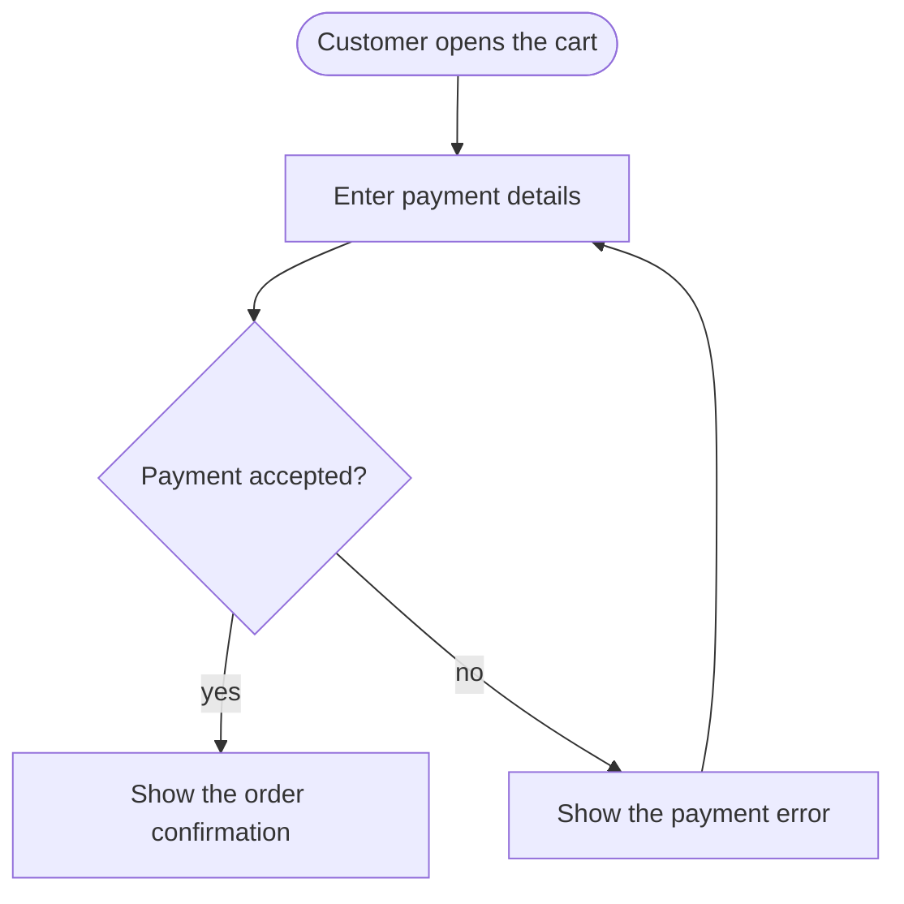

# strata

The living map of your app's use cases, in your terminal.

Every use case gets one Markdown file in `docs/flows/` with a Mermaid flowchart of its steps. Your coding agent writes them and keeps them current as it changes the code; strata checks them, renders them in the terminal and shows what each branch did to them. They are plain Mermaid, so GitHub renders the same files in the browser and in pull requests.

## Quick start

Install the CLI, then run it from your repository root:

```sh
cargo install --git https://github.com/Ross-cripto/strata
strata init
```

Ask your coding agent: **"document the use-case flows of this repo"**.

```sh
strata browse         # see the use cases
strata check          # validate the catalog
strata diff main      # see what your branch changed
```

`strata init` creates `docs/flows/` with a `.gitkeep` and installs the
`strata-flows` skill for Claude Code, Codex and other agents. It keeps existing
flows and differing skills; use `strata init --force` to update those skills.

A real `strata diff --no-color` excerpt from the checkout fixtures, with the
drawing omitted:

```text
flow changes since HEAD (bbf0cdf): 1 modified, 1 new, 1 removed

Checkout (checkout.md)  modified: +1 step, -1 step, ~1 step, +3 links, -3 links, ~1 link
  + step fraud "Fraud check"
  ~ step confirm "Order confirmed" -> "Order confirmed and emailed"
  - step address "Enter address"
  + link cart -> pay
  + link pay -> fraud "yes"
  + link fraud -> confirm
  ~ link pay -> error "no" -> "declined"
  - link cart -> address
  - link address -> pay
  - link pay -> confirm "yes"
```

The base SHA depends on your repository.

## Browse

`strata browse [--base REF]` opens a full-screen catalog browser. The default base
is `HEAD`; `--base main` compares against its merge base with HEAD. Use `--flows
DIR`, `--ascii`, `--no-color` or `--dir TD|BT|LR|RL` as needed. `NO_COLOR` also
selects a plain UI; `--color` has no effect here.

An excerpt of the 120×30 `browse__wide` fixture snapshot:

```text
┌ Flows ───────────────────────┐Pay for an order
│✗ Bad flow                    │tests/fixtures/flows/browse/pay-for-an-order.md
│✗ Broken flow                 │A customer pays for an order and receives a receipt.
│~ Checkout                    │┌ Diagram ─────────────────────────────────────────────────────────────────────────────┐
│· Login                       ││    ╭───────────╮                                                                     │
│! Pay for an order            ││    │ Customer  │                                                                     │
│+ Refund                      ││    ╰─────┬─────╯                                                                     │
│· Wide flow                   ││          │                                                                           │
│- Legacy export               ││          ▼                                                                           │
```

| Key | List focus | Diagram focus |
|---|---|---|
| ↑/↓, k/j | Select a flow | Pan one row |
| ←/→, h/l | | Pan one column |
| H/J/K/L | | Pan ten columns/rows |
| PgUp/PgDn | Select by page | Pan by visible height |
| Home | First flow | Reset pan |
| Tab | Focus diagram; open it on narrow terminals | Focus list |
| Enter | Open diagram on narrow terminals | |
| / | Search title or name | Search title or name |
| d | Toggle diff against the base | Same |
| p | Toggle problems, code anchors and diff details | Same |
| r | Reload flows, checks and anchored code | Same |
| ? | Help | Help |
| q, Ctrl-C | Quit | Quit |
| Esc | Close help → finish search → clear kept filter → narrow list → quit | Same |

Search accepts printable characters, including command letters. ↑/↓ still
select; Backspace deletes; Enter keeps the filter, or clears an empty query.
Ctrl-C quits even while searching. Changed flow files reload automatically;
edits to anchored code outside the catalog refresh on `r`. When git is unavailable
or HEAD has no commit, the status says `no git` and diff mode is disabled.

Markers, in priority order: `✗` (`x` in ASCII) means a parse/check error, `!`
possibly stale, `~` modified, `+` new, `-` removed, and `·` (`.` in ASCII) unchanged.
Removed flows appear last. Diagrams pan without wrapping. Below 80 columns,
Tab switches between the list and diagram views.

Bare `strata` opens the browser only when stdin **and** stdout are terminals,
`CI` is unset, `TERM` is not `dumb`, the catalog (`--flows` or `docs/flows`) exists,
and neither FILE nor `--watch` is supplied. Otherwise it reads stdin as before.
Explicit `strata browse` requires terminal stdout. Build with
`--no-default-features --features cli` for the CLI without the browser; library
embedders can use `default-features = false`.

## What a flow looks like

`docs/flows/check-out-a-cart.md`:

````markdown
# Check out a cart

A customer pays for the items in the cart and gets an order confirmation.


````

- One use case per top-level Markdown file, named in kebab-case, with a title,
  a one-sentence description and one Mermaid flowchart.
- Start from the actor or trigger as a stadium `([...])`. Use rectangles for
  steps and diamonds for decisions, with every exit labelled.
- Keep it to 3 to 15 steps, using the user's words and behaviour verified in code.
- Keep node ids stable: change labels to rename steps. Keep file paths stable,
  because renaming a file reads as removing one flow and adding another.
- Describe the current behaviour. strata computes changes from git.

## Keep flows true: anchors

Tie steps to the code that implements them with Mermaid comments inside the
flow's first Mermaid block, usually at the end before the closing fence:

```text
%% @code pay src/checkout/payment.ts
%% @code confirm src/checkout/confirmation.ts tests/confirmation.ts
%% @code * src/checkout
```

A target is a node id, or `*` for the whole flow. Several patterns on one line
and repeated lines for the same target add up. `strata flows NAME` shows them
in a Code footer. Mermaid and GitHub ignore the comments; rendering is unchanged.
Anchors in prose or any other block are errors.

Paths are relative to the repository root and always match from that root:

- A literal file matches itself; a literal folder matches everything under it.
- `*` matches within one path segment and `?` matches one character in a segment.
- `**` as a whole segment matches zero or more folders: `src/**/pay.rs` also
  matches `src/pay.rs`. In `src/**.rs`, the stars behave like `*.rs`.
- Every other character is literal, including brackets and braces:
  `app/[id]/page.tsx` matches that exact framework path.
- A leading `./` and trailing `/` are removed; repeated `/` separators collapse.
  Absolute paths, drive prefixes, `.` or `..` segments, and backslashes are rejected.
- Patterns are separated by whitespace, so anchor paths cannot contain spaces.

`strata check` reports `anchor-syntax`, `anchor-unknown-step`, and
`anchor-no-match` as errors. It indexes tracked and untracked files through git,
excluding ignored files and files deleted from disk. Outside git, or without the
git binary, it walks the current directory without following directory symlinks.
Update anchors when code moves or is renamed.

`strata diff` compares anchored paths with code changed since the merge base,
including deleted files, both sides of a rename, and non-ignored untracked files.
It appends an advisory section when a flow file was untouched:

```text
possibly stale: 1 flow whose anchored code changed but the flow did not
  Pay for an order (pay.md)
    pay: src/checkout/payment.ts
```

A flow is touched when any byte in its file changed between the base and the
working tree. A touched flow is never reported stale, even when only its prose
or anchors changed. Review stale flows: update them when behaviour changed; if
they still hold, report that instead of making a cosmetic edit to silence the warning.

`strata diff --strict` also exits 1 for possibly stale flows. Use it for local
agent runs or teams that require acknowledgement of every anchored change.
**`strata check --strict` remains the recommended CI gate.** Running
`diff --strict` in CI requires `actions/checkout` with `fetch-depth: 0` so git
can find the merge base.

Run `strata which src/checkout/payment.ts` before editing to find anchored flows
and steps. It only knows anchored flows. Arguments are literal paths relative to
the current directory, or absolute paths; directories expand to indexed files,
and deleted paths still match anchors. Paths outside the repository are rejected.
Pass several paths for separate result blocks, or `--format json` for JSON v1:

```json
{"version":1,"paths":[{"path":"src/pay.rs","flows":[{"name":"pay","path":"docs/flows/pay.md","title":"Pay for an order","steps":["pay"],"whole_flow":false}]}]}
```

## For agents

The `strata-flows` skill teaches how to identify use cases, group entry points
into user journeys, write the format above, and maintain affected flows in the
same change as the code. It also teaches how to check the files and report what
changed, including open questions about behaviour that was not verified.

`strata init` installs the skill at the repository root in
`.claude/skills/strata-flows/SKILL.md` for Claude Code and
`.agents/skills/strata-flows/SKILL.md` for Codex and other agents. From a
subdirectory, it still installs skills at the root while creating the catalog
relative to the current directory. The installed skill records that catalog's
path relative to the root. Run strata from the root when following the skill.

To install only the skill through the skills CLI:

```sh
npx skills add Ross-cripto/strata
```

Both installers use the source at `skills/strata-flows/SKILL.md`. `strata init`
prints a reminder when git ignores an installed skill, so you can make it
available to teammates. It follows symlinked skill directories, including those
created by the skills CLI.

For agents to keep flows current on every task, add this line to `AGENTS.md`
and `CLAUDE.md` (init prints it, and leaves those files for you to edit):

```text
Use-case flows live in docs/flows/ (strata-flows skill): update them when behaviour changes and run `strata check`.
```

For agents without skill support, `strata guide` prints the skill body.
`strata guide --flows flows` renders its paths for a custom catalog.

## Commands

| Command | Result |
|---|---|
| `strata init [--force]` | Create the catalog and install the agent skill; `--force` updates differing skills |
| `strata browse [--base REF]` | Explore the catalog interactively (for humans; agents use the other commands) |
| `strata flows [NAME]` | List the catalog, or render one use case |
| `strata flows --format json` | List catalog metadata as JSON v1; cannot be combined with NAME |
| `strata check [--strict] [--format text\|json]` | Validate the catalog; `--strict` also fails on warnings |
| `strata diff [REF] [--strict]` | Compare with the merge base of REF and HEAD; `--strict` also exits 1 for possibly stale flows |
| `strata which <file>... [--format text\|json]` | Show flows and steps anchored to files or directories |
| `strata guide` | Print the agent skill body |
| `strata FILE` | Render a Mermaid file, or every Mermaid block of a Markdown file |
| `strata completions SHELL` | Generate completions for bash, zsh, fish, powershell or elvish |

`strata check` prints each problem with its catalog path, line when available,
severity and code, followed by a summary such as `checked 3 flows: ok`.
Exit 1 means errors, warnings with `--strict`, or a command failure such as a
missing catalog. Warnings alone exit 0; an empty catalog produces one warning.

| Check code | Severity | Meaning |
|---|---|---|
| `missing-title` | error | No ATX title heading (`# Title`) |
| `missing-description` | error | No prose description after the title |
| `missing-diagram` | error | No Mermaid block |
| `not-a-flowchart` | error | The first Mermaid block does not start with a flowchart/graph header |
| `parse-error` | error | The first diagram cannot be parsed |
| `empty-diagram` | error | The flowchart has no steps |
| `unclosed-fence` | error | A code fence is never closed |
| `duplicate-name` | error | Another file has the same stem |
| `unreadable` | error | A flow file cannot be read as UTF-8 |
| `anchor-syntax` | error | An invalid anchor or an anchor outside the first Mermaid block |
| `anchor-unknown-step` | error | An anchor targets a node id the flowchart does not have |
| `anchor-no-match` | error | An anchor path matches no file in the repository |
| `extra-diagram` | warning | Another Mermaid block follows the first |
| `duplicate-title` | warning | An earlier file has the same title, ignoring case and surrounding whitespace |
| `empty-catalog` | warning | No flow files |
| `ignored-entry` | warning | A subdirectory or non-flow file is ignored |
| `mmd-flow` | warning | A `.mmd` file lacks the Markdown title and description format |
| `no-actor` | warning | No stadium-shaped actor or trigger |
| `unlabelled-branch` | warning | A decision has an exit without a label |
| `unlabelled-step` | warning | A step's label is just its id |
| `too-many-steps` | warning | More than 15 steps |
| `too-few-steps` | warning | Fewer than 3 steps |
| `styling` | warning | Diagram styling is ignored by strata |
| `file-name` | warning | The file stem is not kebab-case |
| `long-label` | warning | A node label line is wider than 40 display columns |
| `edge-into-actor` | warning | An edge targets a stadium actor node |

Tools can read one-line JSON from `strata check --format json`:

```json
{"version":1,"catalog":"docs/flows","flows":3,"errors":1,"warnings":0,"problems":[{"path":"docs/flows/checkout.md","line":5,"severity":"error","code":"parse-error","message":"link has no target node"}]}
```

`path` and `line` are `null` when absent. A missing catalog exits 1, reports the
error on stderr, and leaves stdout empty, including in JSON mode.

`strata flows --format json` returns catalog metadata:

```json
{"version":1,"flows":[{"name":"checkout","path":"docs/flows/checkout.md","title":"Checkout","description":"A customer pays for the cart.","has_diagram":true}]}
```

Global flags can appear before or after a subcommand:

| Flag | Effect |
|---|---|
| `--flows DIR` | Catalog directory, default `docs/flows`, relative to the current directory |
| `--dir TD\|BT\|LR\|RL` | Override flowchart direction; `--dir=LR` also works |
| `--ascii` | Use plain ASCII instead of box-drawing characters |
| `--color` | Force ANSI colour, including when NO_COLOR is set |
| `--no-color` | Disable ANSI colour; otherwise colour is automatic on a TTY and respects NO_COLOR |
| `-w`, `--watch` | Re-render on every file change; applies only to rendering a file |
| `-h`, `--help` | Print help |
| `-V`, `--version` | Print version |

The command words `init`, `flows`, `check`, `diff`, `which`, `guide` and `completions`
are reserved. To render a file with one of those names, use `./diff` or
`strata -- diff`. `help` remains a file name; use `--help` or `-h` to print help.
`init` requires a relative catalog path because the installed skill is committed.

## The renderer

Mermaid flowcharts render as clean, readable terminal diagrams. Keep a diagram
open in a side pane while you (or your agent) work on the code:

```sh
strata docs/architecture.mmd           # render once
strata --watch docs/architecture.mmd   # redraw on every save
cat flow.mmd | strata --dir=LR         # stdin, override direction
```

The source of truth is plain Mermaid in your repo, so diagrams diff, review
and version like code. The layout engine is where the work went, because
that's where terminal diagram tools usually fall apart.

In watch mode an invalid edit keeps the last good diagram on screen with the
parse error underneath, so a half-written change from an agent doesn't blank
the pane.

Supported Mermaid: `flowchart`/`graph` with TD/TB/BT/LR/RL; shapes `[]`,
`()`, `([])`, `[[]]`, `[()]`, `(())`, `{}`, `{{}}`; quoted labels and
`<br>`; chains (`a --> b --> c`); `&` fan-out; solid `-->`, dotted `-.->`,
thick `==>`, open `---`, bidirectional `<-->`; labels as `-->|x|` or
`-- x -->`; nested `subgraph … end`. Styling statements (`classDef`,
`style`, `linkStyle`, `click`) are accepted and ignored.

Each changed flow includes a union drawing: `+` means added (green), `-` removed (red), and `~` changed (yellow).
A current flow with a parse error is reported at its file line while the
other flows still render; the command exits 1. With no changes it prints
one line, `no flow changes since HEAD (<sha7>)`, and exits 0.

Catalogs contain top-level `.md` or `.mmd` files. `.mmd` files use the whole
file as their diagram. `strata FILE.md` renders every Mermaid block under
its nearest heading, and `strata --watch FILE.md` redraws them on save.

### How the layout works

```
parse → break cycles → rank → split long edges → order → size → position → route → draw
```

| Stage | What it does | Why it matters in a terminal |
|---|---|---|
| Break cycles | Adds edges in declaration order and reverses only the ones that close a cycle | The edge drawn "backwards" is the one you wrote as feedback (`retry`), not an arbitrary one |
| Rank | Longest path, then median balancing on edge length | Sources and sinks sit next to their neighbours instead of stranded at the top or bottom |
| Split long edges | Edges spanning several layers get pass-through points; labelled edges get a dedicated label row | Labels never collide with nodes or other edges |
| Order | Barycenter sweeps plus adjacent transposition, keeping each subgraph contiguous between its border chains | Fewer crossings; clusters never interleave |
| Position | Per layer, weighted least squares under spacing constraints (isotonic regression via pool-adjacent-violators), then relaxation | Siblings spread symmetrically under a parent; long edges stay straight |
| Clusters | Each side snaps to one straight line hugging its members; columns are inserted for titles | Tight boxes that never contain outsiders |
| Route | Ports placed per edge, buses for fan-out, tracks ordered so a vertical never cuts a horizontal it could avoid | Orthogonal, readable wiring; straight lines wherever geometrically possible |
| Draw | Lines stored as per-cell connection flags and resolved to glyphs at the end | Correct junctions (`┬ ┴ ├ ┼`) regardless of draw order; crossings render as hops, not fake junctions |

All coordinates are abstract (rank axis × order axis), so TD, BT, LR and RL
share one code path. Dotted edges use `┄┆`, thick use `━┃`, cluster borders
use a fainter `┈┊`, and edges crossing a cluster border interrupt the border,
not the edge.

### Library

The CLI is a thin wrapper around the crate, so a TUI or an MCP server can embed it:

```rust
let options = strata::Options::default();
let text = strata::render_str(source, &options)?;
let document = strata::render_markdown(markdown, &options)?;

let old = strata::parser::parse(old_source)?;
let new = strata::parser::parse(new_source)?;
let changes = strata::diff::diff(&old, &new);
let summary = changes.summary();
let drawing = strata::render_diagram(&changes.union, &options);
```

For the library only, disable the default CLI feature:

```toml
strata = { version = "0.5", default-features = false }
```

To install from a local checkout, run `cargo install --path .`.

## Development

Rust 1.88 is the minimum supported version (MSRV); the crate uses edition 2024.
Run `cargo test` for the full suite and `cargo test --no-default-features` for
library-only tests. Run `cargo fmt --all --check` and
`cargo clippy --all-targets --all-features -- -D warnings` before submitting changes.

The default features are `cli` and `tui`. `cli` enables clap, clap_complete, anyhow, notify and serde_json; `tui` adds ratatui only to the binary.
Run `cargo test --no-default-features --features cli --locked` to test the CLI without the browser.
With `default-features = false`, normal library dependencies are only
unicode-width and thiserror.

Review snapshot updates with `cargo insta review` (requires cargo-insta), or run
`INSTA_UPDATE=always cargo test` and inspect the diff before accepting changes.

### Tests

`cargo test` checks invariants across every fixture in all four directions:
exactly one arrowhead per arrow end, every node and edge label visible, no
dangling line ends, deterministic output, and pure-ASCII output in `--ascii` mode.
The flow tests also check Markdown extraction, union diagrams and state colours,
catalog classification, and CLI behaviour against temporary git repositories
with committed and uncommitted changes. The test suite requires the `git` binary.

## Known limits

- Anchor paths cannot contain spaces; symbol anchors and line ranges are not supported.

- Front matter needs a `key:` line immediately after the opening `---`; otherwise it is a thematic break.
- Flowcharts only, no sequence/class/ER diagrams yet.
- Self-loops are shown as a `↻` marker on the node; self-loop changes appear only in the diff summary and details.
- Node ids are the identity; changing an id reads as a removal plus an addition.
- Only the first mermaid block of a catalog flow file is compared. Prose, titles, direction and cluster membership are not diffed.
- Edges to a subgraph id (`a --> mySubgraph`) treat the id as a node.
- LR diagrams with many layers get wide; TD is the better default for big systems.
- Edges entering a cluster cross its border wherever they arrive rather than at a dedicated gate.
- README.md in a catalog is ignored, ignoring case. Hidden files are also skipped. `check` reports dangling flow symlinks as unreadable; `flows` and `diff` skip them.

## Roadmap

1. Done: code anchors and `strata which` connect use cases to their code, with validation and stale detection.
2. Done: an interactive browser for exploring the catalog and diagrams wider than the terminal.
3. Packaged releases to make installation easier.
