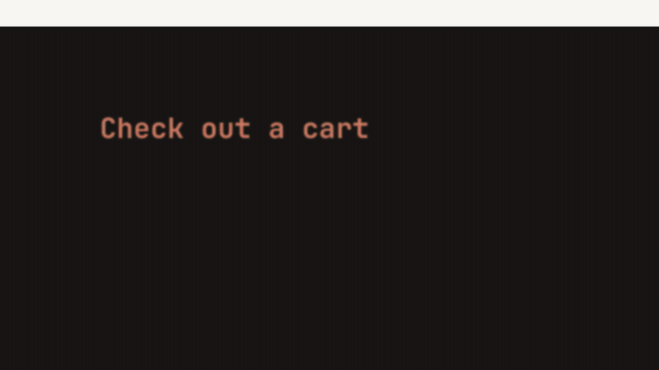
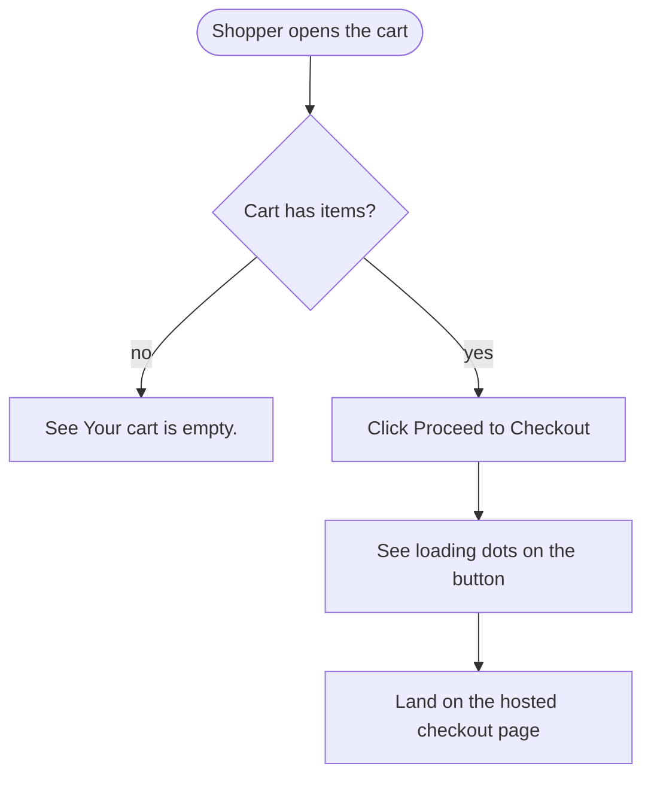
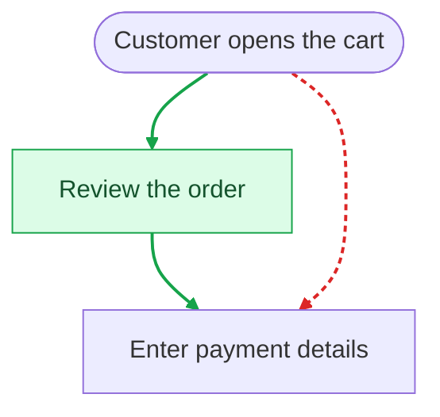

# casemap

**The living map of your app's use cases.**

One small flowchart per use case, written by your coding agent, kept true as the
code changes, and drawn on every pull request.

[](https://crates.io/crates/casemap)
[](https://github.com/Ross-cripto/casemap/actions/workflows/ci.yml)
[](LICENSE)

<!-- GitHub plays the video and drops the GIF; crates.io drops the video tag and keeps the GIF. -->
<video src="https://github.com/user-attachments/assets/048348a7-0a74-4345-bdc4-63f0f8bdeb9d" controls muted>
  
</video>

## Why

Coding agents change a lot of code, fast. A few weeks in, nobody can say what
the app does for its users: the code is too big to read, and the spec written
for each change is out of date the day it merges.

casemap keeps one flow per use case, such as "check out a cart" or "reset a
password", in `docs/flows/` next to the code. Your agent writes the flows from
the code and updates them in the same change as the code; casemap checks them
and tells you when one has drifted. Reviewers see what a pull request did to the
use cases, not only to the files.

## How it works

1. **Run `casemap` in your repository.** With no flows yet, it offers to have
   Claude Code or Codex map the repo.
2. **Your agent writes the flows:** one Markdown file per use case, grouped into
   a map of what users do.
3. **The map stays true.** The agent updates flows as it changes code,
   `casemap check` guards CI, and each pull request shows the use cases it changed.

A flow is a title, one sentence and a Mermaid flowchart, so GitHub renders it too:

````markdown
# Check out a cart

A shopper with items in the cart goes to the store's hosted checkout.


````

In the terminal, `casemap flows check-out-a-cart` draws it:

```text
Check out a cart
A shopper with items in the cart goes to the store's hosted checkout.

                                ╭─────────────────────────╮
                                │ Shopper opens the cart  │
                                ╰────────────┬────────────╯
                                             │
                                             ▼
                                    ╱─────────────────╲
                                   <  Cart has items?  >
                                    ╲────────┬────────╱
             ╭───────────────────────────────┤
             │                               │
            no                              yes
             │                               │
             ▼                               ▼
┌─────────────────────────┐    ┌───────────────────────────┐
│ See Your cart is empty. │    │ Click Proceed to Checkout │
└─────────────────────────┘    └──────────┬────────────────┘
                                          │
                                          ▼
                         ┌─────────────────────────────────┐
                         │ See loading dots on the button  │
                         └───────────────┬─────────────────┘
                                         │
                                         ▼
                       ┌───────────────────────────────────┐
                       │ Land on the hosted checkout page  │
                       └───────────────────────────────────┘
```

`casemap map` shows the whole app by user activity:

```text
 docs/flows · 9 use cases in 3 activities

 ╭─ Find products ──────╮   ╭─ Choose and buy ─────╮   ╭─ Sync the store ─────╮
 │ 4 use cases          │ ▶ │ 4 use cases          │ ▶ │ 1 use case           │
 ╰──────────────────────╯   ╰──────────────────────╯   ╰──────────────────────╯
 · Browse the storefront    · View a product and       · Refresh the catalogue
 · Browse a collection        choose options             after a store edit
 · Search for products      · Add an item to the cart
 · Read a store page        · Manage the cart
                            · Check out a cart
```

These are the use cases of [Next.js Commerce](https://github.com/vercel/commerce),
mapped by a coding agent. Explore all nine in [`examples/commerce`](examples/commerce),
on GitHub or with `cd examples/commerce && casemap`.

## Install

```sh
brew install Ross-cripto/tap/casemap
```

Without Homebrew, use the installer for your platform or build from source:

```sh
# macOS and Linux
curl --proto '=https' --tlsv1.2 -LsSf https://github.com/Ross-cripto/casemap/releases/latest/download/casemap-installer.sh | sh
# Windows (PowerShell)
powershell -ExecutionPolicy Bypass -c "irm https://github.com/Ross-cripto/casemap/releases/latest/download/casemap-installer.ps1 | iex"
# From source (Rust 1.88 or newer)
cargo install --git https://github.com/Ross-cripto/casemap
```

Prebuilt binaries for macOS, Linux and Windows are attached to each
[release](https://github.com/Ross-cripto/casemap/releases).

Then run `casemap` in your repository. To set up by hand, run `casemap init` and
ask your coding agent: **"document the use-case flows of this repo"**.

## What you get

**Browse the catalog.** `casemap browse` opens a full-screen browser: every flow
with a status marker, pannable diagrams, search, and a diff against any branch.
[Browse →](docs/browse.md)

**Validate in CI.** `casemap check` reports every problem with file and line, as
text or JSON; `casemap check --strict` is the CI gate.
[Commands and check codes →](docs/commands.md)

**Keep flows tied to code.** `%% @code` anchors link steps to the code behind
them. `casemap which` tells the agent which flows a file touches, and
`casemap diff` flags flows whose code changed while the flow did not.
[Anchors →](docs/anchors.md)

**Plan a change first.** `casemap propose` previews how a planned change alters a
flow before any code is written.
[Plan a change →](docs/agents.md#plan-a-change-first)

**Review pull requests.** The GitHub Action keeps one comment on each pull
request with the changed use cases drawn in colour. A reviewer sees this when a
change adds a step:



[Review changes →](docs/review.md)

**Find code no flow covers.** `casemap coverage` lists it for the whole
repository or for a branch. [Coverage →](docs/coverage.md)

**Catch stale flows before the agent finishes.** `casemap init --hooks` installs a
Stop hook for Claude Code and Codex that asks the agent, once, to update the
flows its changes left behind. [Agent hooks →](docs/agents.md#agent-hooks)

## Documentation

The [documentation](docs/README.md) covers the flow and map format, every
command and flag, check codes, JSON output, the GitHub Action and agent setup.

## Contributing

Contributions are welcome: see [CONTRIBUTING.md](CONTRIBUTING.md). casemap is
[MIT licensed](LICENSE).
