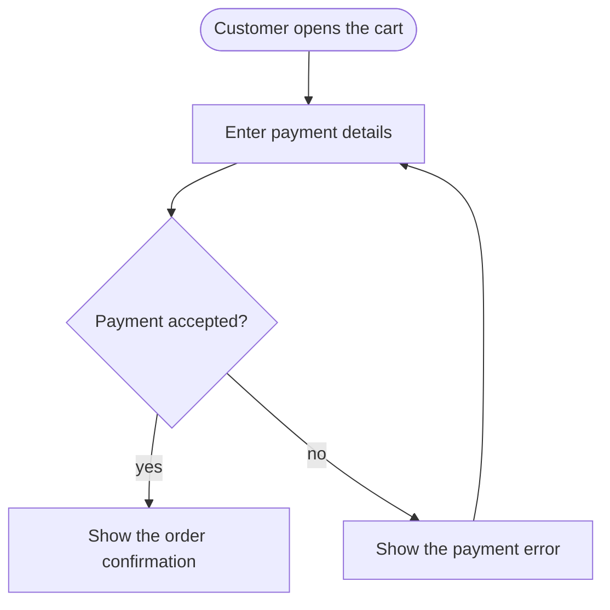

# Flows and the map

Each use case is one Markdown file in the catalog (`docs/flows/` by default), and the catalog's `README.md` groups them into a map of user activities.

## What a flow looks like

`docs/flows/check-out-a-cart.md`:

````markdown
# Check out a cart

A customer pays for the items in the cart and gets an order confirmation.


````

- One use case per top-level Markdown file, named in kebab-case, with a title,
  a one-sentence description and one Mermaid flowchart.
- Start from the actor or trigger as a stadium `([...])`. Use rectangles for
  steps and diamonds for decisions, with every exit labelled.
- Keep it to 3 to 15 steps, using the user's words and behaviour verified in code.
- Keep node ids stable: change labels to rename steps. Keep file paths stable,
  because renaming a file reads as removing one flow and adding another.
- Describe the current behaviour. Casemap computes changes from git.

## The map

The catalog's `README.md` groups use cases under the user's activities, in
journey order. GitHub renders it when you open the catalog folder:

```markdown
# Shop use-case map

What shoppers do, from finding a product to paying.

## Find products

A shopper looks for something to buy.

- [Browse the storefront](browse-the-storefront.md)
- [Search for products](search-for-products.md)

## Choose and buy

A shopper picks a product and pays.

- [Check out a cart](check-out-a-cart.md)
```

Use `##` headings for activities and flow titles as link text. Each flow belongs
to exactly one activity. `casemap check` reports unknown or duplicate links,
missing flows and mismatched link titles. Ask your coding agent to write and
maintain the map; an ordinary README without activity links stays an ordinary
README.

`casemap map --no-color` draws this commerce catalog at 80 columns:

```text
 docs/flows · 9 use cases in 3 activities

 ╭─ Find products ──────╮   ╭─ Choose and buy ─────╮   ╭─ Sync the store ─────╮
 │ 4 use cases          │ ▶ │ 4 use cases          │ ▶ │ 1 use case           │
 ╰──────────────────────╯   ╰──────────────────────╯   ╰──────────────────────╯
 · Browse the storefront    · View a product and       · Refresh the catalogue
 · Browse a collection        choose options             after a store edit
 · Search for products      · Add an item to the cart
 · Read a store page        · Manage the cart
                            · Check out a cart
```

When the grid does not fit, the map becomes an outline with each activity's
sentence and its flows. `--layout grid` or `--layout outline` forces a layout.
Width comes from a positive `COLUMNS`, otherwise the stdout terminal when
available, otherwise 80. `--ascii` replaces the box-drawing symbols with ASCII.

`casemap flows` and `casemap browse` use the same activity order, with flows not
on the map last. Browse search keeps the headings of matching groups, and the
diagram header shows the activity and the flow's position within it. Without a
map, both commands keep their flat lists.

## Catalog files

Catalogs contain top-level `.md` or `.mmd` files. `.mmd` files use the whole file as their diagram.
