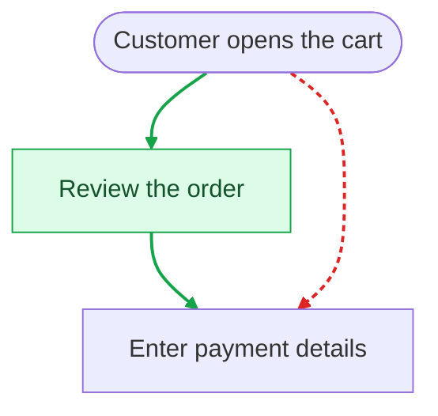

# Review changes

## casemap diff

A real `casemap diff --no-color` excerpt from the checkout fixtures, with the
drawing omitted:

```text
flow changes since HEAD (bbf0cdf): 1 modified, 1 new, 1 removed

Checkout (checkout.md)  modified: +1 step, -1 step, ~1 step, +3 links, -3 links, ~1 link
  + step fraud "Fraud check"
  ~ step confirm "Order confirmed" -> "Order confirmed and emailed"
  - step address "Enter address"
  + link cart -> pay
  + link pay -> fraud "yes"
  + link fraud -> confirm
  ~ link pay -> error "no" -> "declined"
  - link cart -> address
  - link address -> pay
  - link pay -> confirm "yes"
```

The base SHA depends on your repository.

Each changed flow includes a union drawing: `+` means added (green), `-` removed (red), and `~` changed (yellow).
A current flow with a parse error is reported at its file line while the
other flows still render; the command exits 1. With no changes it prints
one line, `no flow changes since HEAD (<sha7>)`, and exits 0.

## On pull requests

Run `casemap init --ci` to install the agent skill and add
`.github/workflows/casemap.yml`, or add the workflow yourself:

```yaml
name: casemap

on:
  pull_request:

permissions:
  contents: read
  pull-requests: write

jobs:
  flows:
    runs-on: ubuntu-latest
    steps:
      - uses: actions/checkout@v6
        with:
          fetch-depth: 0
      - uses: Ross-cripto/casemap@v0
        with:
          flows: docs/flows
```

The Action keeps one comment updated on each pull request, with coloured Mermaid
flow changes, possibly stale flows, changed code no flow covers and the `check`
result. It also writes the report to the job summary. Fork PRs with read-only tokens fall back to that
summary with a notice. When flows have @code anchors, a pull request that changes code no flow covers gets a comment even if no flow changed.
Linux and macOS runners are supported. Checkout must use
`fetch-depth: 0` so the base revision and its merge base are available.

Only `check` errors, including broken diagrams, fail the flow review job.
Warnings and possibly stale flows are advisory. For local runs,
`casemap diff main --format markdown` prints the same report;
adding `--strict` also fails on possibly stale flows.

A modified flow with an added review step looks like this in the comment:

### 🗺️ casemap · 1 use case changed · 0 possibly stale · check ok
Compared with `main` (abc1234).

#### ~ Check out a cart · `docs/flows/check-out-a-cart.md`
+1 step, +2 links, -1 link



<details><summary>Changes</summary>

- + step review "Review the order"
- + link cart -> review
- + link review -> pay
- - link cart -> pay
</details>

#### Check

ok

The Action accepts these inputs:

| Input | Default | Purpose |
|---|---|---|
| `version` | `latest` | Release version to install, without `v`, such as `0.5.1` |
| `casemap` | empty | Path to an existing binary; skips installation |
| `flows` | `docs/flows` | Flow catalog directory |
| `base` | `origin/${{ github.base_ref }}` | Revision to compare with (using its merge base with HEAD) |
| `comment` | `true` | Set to `false` to write only the job summary |
| `bot-login` | `github-actions[bot]` | Login that owns comments posted with an app token or PAT |
| `token` | `${{ github.token }}` | Token for reading and updating the PR comment |

The moving `v0` Action tag follows releases. A quiet first report creates no
comment; an existing comment is updated even when the PR becomes quiet.
`init --ci` keeps a differing workflow unless you pass `--force`.
